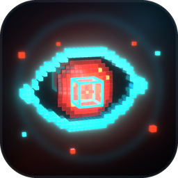
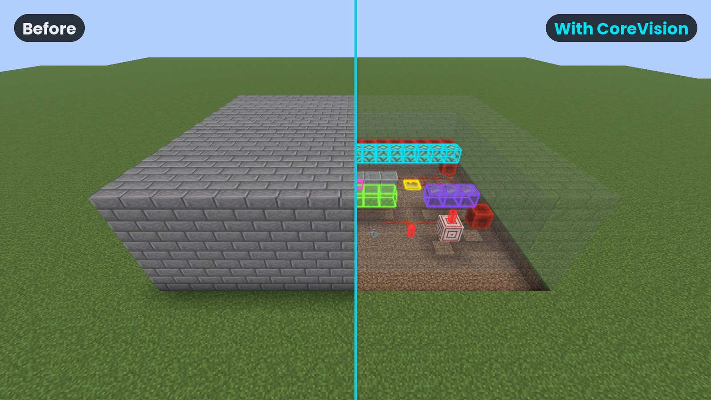
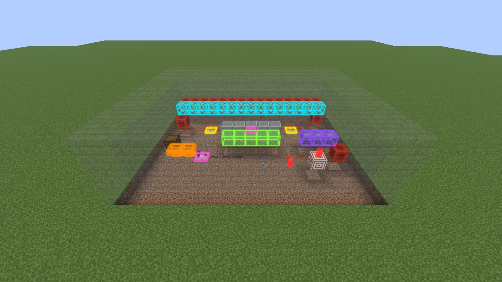
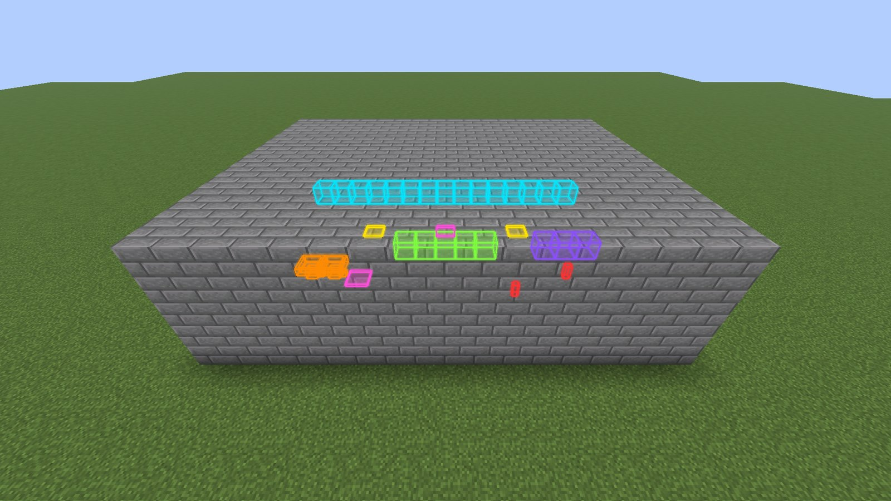
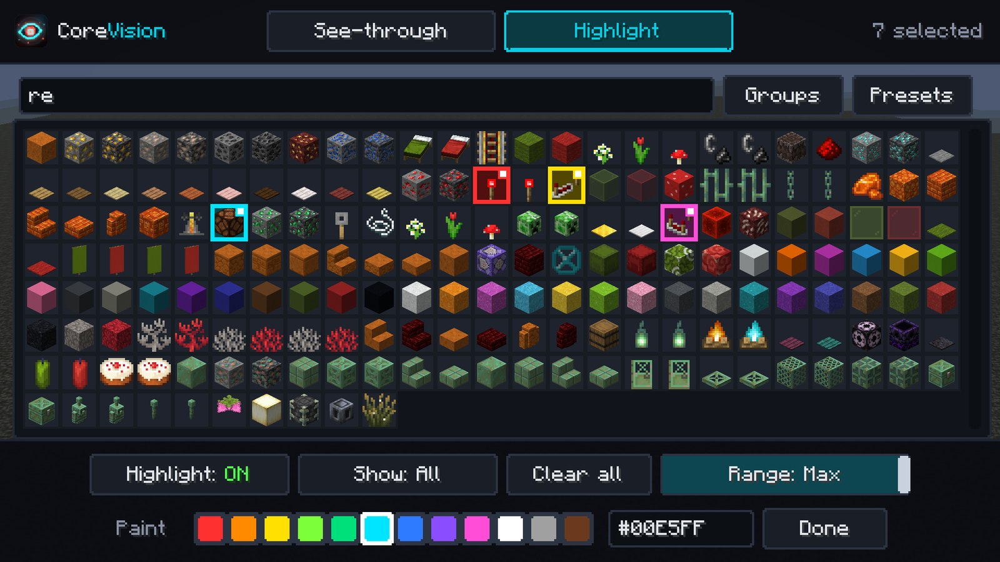
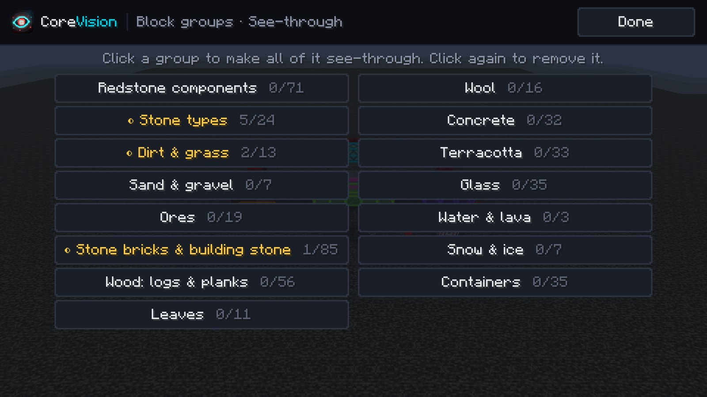

  

<h1 align="center">CoreVision</h1>

<b>See through walls. Highlight what matters.</b> 
A client-side Fabric mod for Minecraft 1.21.11, built for redstoners.

  <a href="CoreVision.jar"><b>Download CoreVision.jar</b></a>

## What it does

CoreVision lets you look inside your builds without breaking anything. Pick any block and make it see-through, then light up the blocks you care about through walls, each in its own colour.

- **See-through blocks:** choose any blocks and set how transparent they are, from 0% to 100%.
- **Through-wall highlights:** glowing outlines show the blocks you pick through any wall, from 16 blocks away up to your full render distance.
- **A colour for every block:** paint each highlighted block its own colour from the palette or with a hex code.
- **Sunlit insides:** blocks next to see-through ones are lit as if the sun reaches them, so sealed rooms aren't pitch black.
- **Block groups:** add whole groups at once, like redstone components, stone types, ores or containers (15 groups).
- **Presets:** save different setups and switch between them from the menu or with a key.
- **Block entities and water:** chests, signs and other block entities fade too, and water keeps its sides.
- **Sodium compatible:** works with the vanilla renderer and with Sodium.

## Controls

| Key | Action |
| --- | --- |
| `V` | Open the menu |
| `B` | Toggle see-through |
| `N` | Toggle highlights |
| Unbound | Next preset |

Change any of them in Options > Controls, under CoreVision.

## Install

1. Install the [Fabric Loader](https://fabricmc.net/use/installer/) for Minecraft 1.21.11.
2. Put [Fabric API](https://modrinth.com/mod/fabric-api) for 1.21.11 in your `mods` folder.
3. Put `CoreVision.jar` in the same `mods` folder.
4. Launch the Fabric profile, join a world and press `V`.

Settings are saved in `config/redstone-vision.json`.

## Playing on servers

CoreVision is made for building and fixing your own redstone. Because it can show blocks through walls, many multiplayer servers do not allow mods like it. Check a server's rules before you use it there.

## Screenshots

## License

All rights reserved. You may download and use CoreVision, but you may not re-upload or redistribute it.

Not an official Minecraft product. Not approved by or associated with Mojang or Microsoft.
